## Introduction to Git Version Control

Refer and complete all videos and quizes in [learngit.io](https://learngit.io/)

## Using Remote Repositories

To extend git from local repositories to remote repositories, you need to setup ssh key and configure your git client to use it. This allows you to securely connect to remote repositories hosted on platforms like GitHub, GitLab, or Bitbucket.

Refer to the [GitHub SSH Key Setup Guide](https://docs.github.com/en/authentication/connecting-to-github-with-ssh/generating-a-new-ssh-key-and-adding-it-to-the-ssh-agent) for detailed instructions on generating and adding an SSH key to your GitHub account.

## General Working of Local vs Remote Repositories

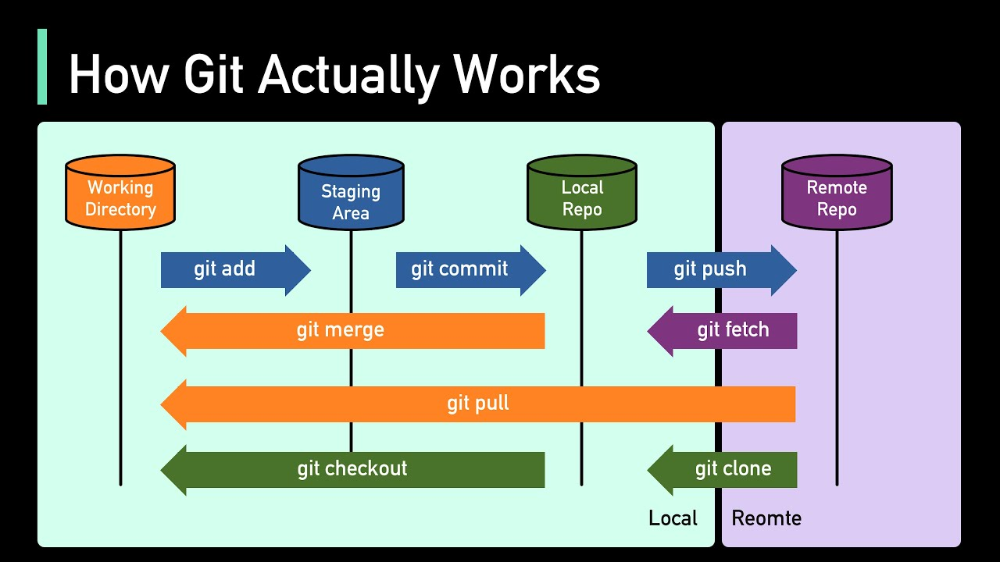

Here, are some commands not covered in the above videos and quizzes that you can use to work with remote repositories:

### Cloning a Remote Repository

```bash
git clone <repository-url>
```

This command creates a local copy of a remote repository. Replace `<repository-url>` with the URL of the repository you want to clone.

### Adding a Remote Repository

```bash
git remote add origin <repository-url>
```

This command adds a remote repository to your local git configuration. Replace `<repository-url>` with the URL of the remote repository you want to add.

### Pushing Changes to a Remote Repository

```bash
git push origin <branch-name>
```

This command pushes your local changes to the specified branch of the remote repository. Replace `<branch-name>` with the name of the branch you want to push to.

### Fetching Changes from a Remote Repository

```bash
git fetch origin
```
This command fetches changes from the remote repository without merging them into your local branch. It updates your local copy of the remote branches.

### Pulling Changes from a Remote Repository

```bash
git pull origin <branch-name>
```
This command fetches and merges changes from the specified branch of the remote repository into your local branch

>__NOTE:__ Always run `git fetch` before `git pull` to ensure you have the latest changes from the remote repository.

> Also make it a habit to run `git fetch` and `git pull` EVERYDAY before starting any new work to avoid conflicts and ensure you are working with the most up-to-date code.


### Stashing Changes
```bash
git stash
```
This command temporarily shelves (or stashes) changes you've made to your working directory so you can work on something else, and then come back and re-apply them later on. Useful when you need to switch branches but aren't ready to commit your changes or need to pull updates from the remote repository without losing your current work.


## Working with Remote Repositories

In the CIE Organisation, only a few maintainers have admin access to the remote repositories. Maintainers github ID are listed in the repositories README. If you are a contributor, you will need to fork the repository and create a __pull request__ to propose changes.

### Creating a Fork of a Repository

To make changes to a repository you don't have write access to, you can create a fork. A fork is a personal __server-side__ copy of the repository that allows you to freely experiment with changes without affecting the original project.

To create a fork, navigate to the repository on GitHub and click the `Fork` button in the upper right corner. This will create a copy of the repository under your GitHub account.

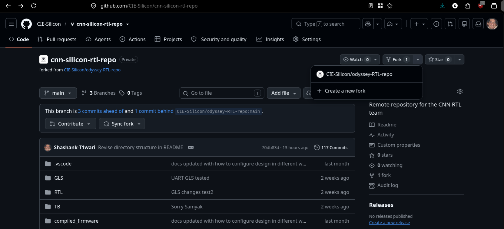

Click `+ Create a new fork`

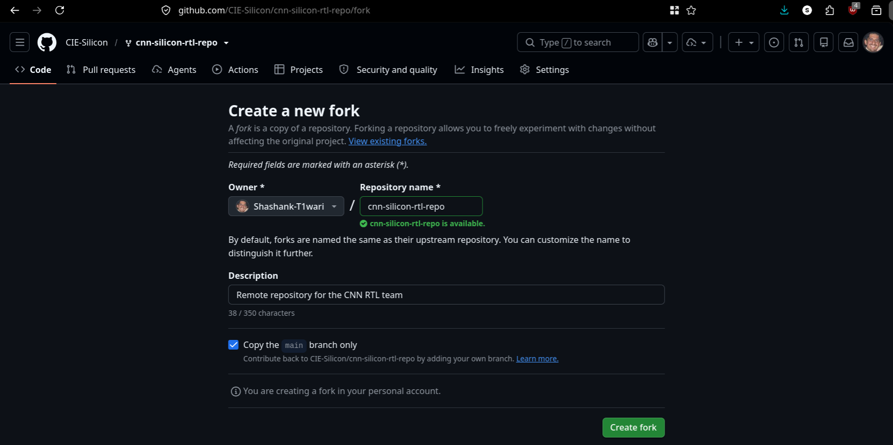

Click `Create fork` to create a copy of the repository under your GitHub account.

So this how the forked repository looks like in your GitHub account.

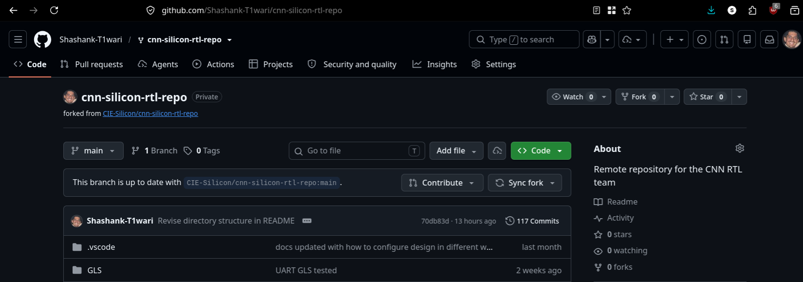

So each contributor will have their own forked repository and will look something like this:

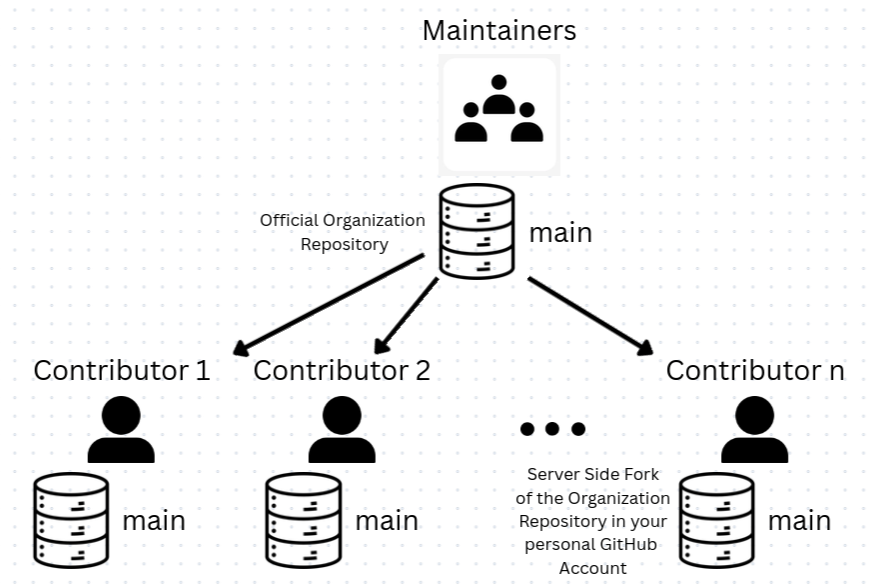

Now to contribute and make changes and patches, clone this forked repository to your local machine using the `git clone` command.

```bash
git clone <forked-repository-url>
```

Repository URL can be found in the `Code` button on the forked repository page.

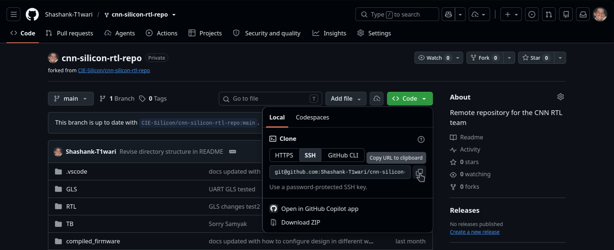

> NOTE: You need to link your local git with GitHub account using the SSH key you created earlier otherwise you will not be able to push your changes to the forked repository.

## Making Changes and Patches

Now, once you have cloned the forked repository to your local machine first make a new feature branch to work on your changes. This is a good practice to keep your changes organized and separate from the main codebase.

Thus,

`main` branch -> In sync with the original repository, contains stable code.

`feature` branch -> Contains your changes and patches.

To create a new feature branch, use the following command:

```bash
git checkout -b <feature-branch-name>
```

Once you have made your changes in the feature branch, commit your changes using the following command:

```bash
git add .
git commit -m "Your commit message"
```
Then push your changes to your forked repository on GitHub using the following command:

```bash
git push origin <feature-branch-name>
```

Before creating a pull request, make sure your forked repository is up to date with the original repository.

To sync your server-side forked repository with the original repository click the `Sync fork` button on your forked repository page.

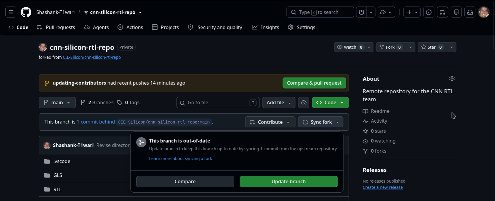

Click `Update branch` to sync your forked repository with the original repository.

Once updated `Sync fork` button will show this message:

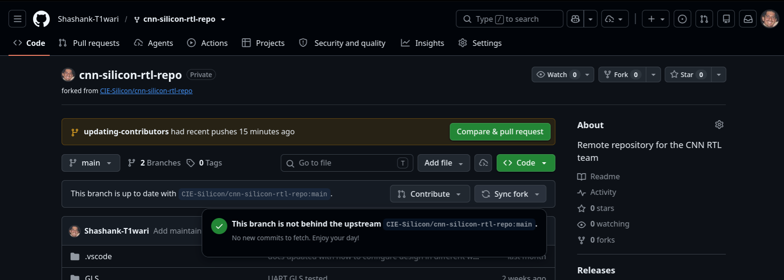

After the Server-side fork is updated, you need to update your local repository main branch with the changes from the original repository.

To this, first checkout to your local main branch and then pull the changes from the original repository using the following commands:

```bash
git checkout main
git pull origin main
```

Then you need to merge the changes from the main branch to your feature branch using the following command:

```bash
git checkout <feature-branch-name>
git merge main
```
Add the necessary merge commit message and push the changes to your forked repository using the following command:

```bash
git push origin <feature-branch-name>
```

## Creating a Pull Request

To create a pull request, navigate to your forked repository on GitHub.

Look for a yellow banner at the top that says: *"your-feature-branch had recent pushes..."* Click the green `Compare & pull request` button inside that banner.

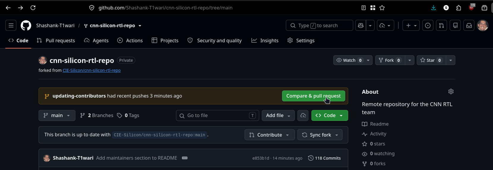

Add a brief Description of the changes you made in the pull request and click `Create pull request` button.

(Follow the format mentioned in CONTRIBUTORS.md file of the repository for writing the description of your changes.)

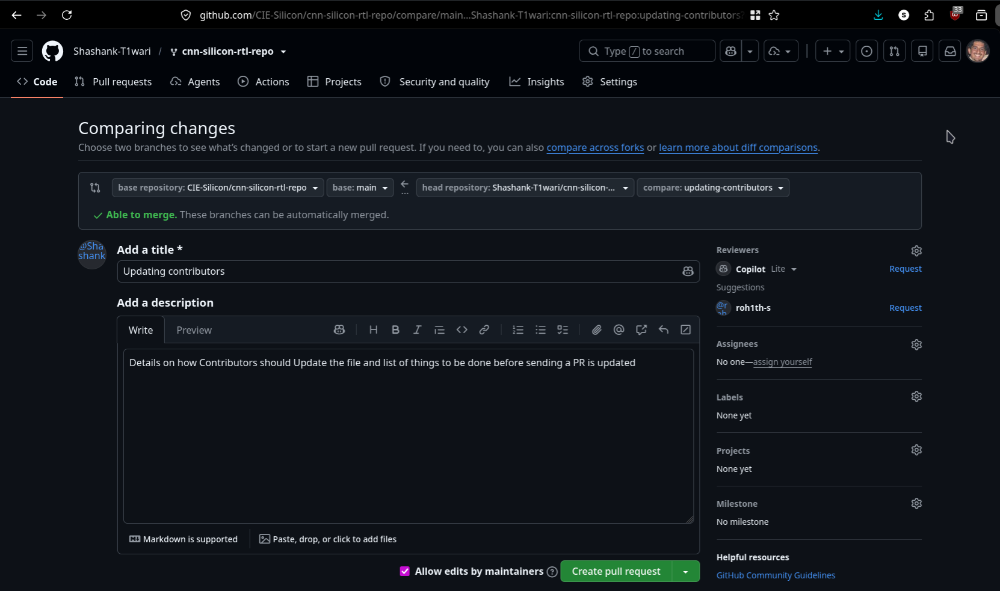

If you scroll down, you can also review the changes you made in the pull request. Once you are satisfied with your changes, click `Create pull request` button.

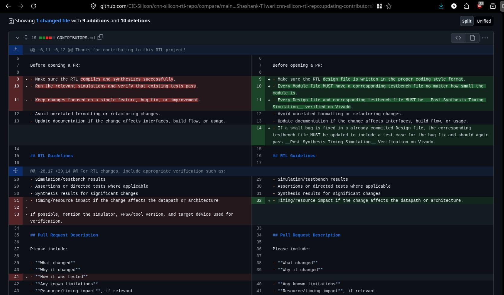

Once the pull request is created, the maintainers of the original repository will review your changes. They may provide feedback or request modifications before merging your changes into the main codebase.

You can see the status of your pull request and any comments from the maintainers on the pull request page of the original repository.

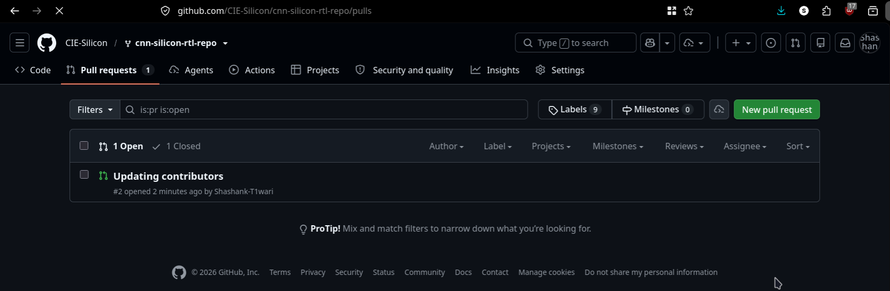

Once the contribution is approved and merged, it will be reflected in the original repository. You can check the original repository to see your changes.

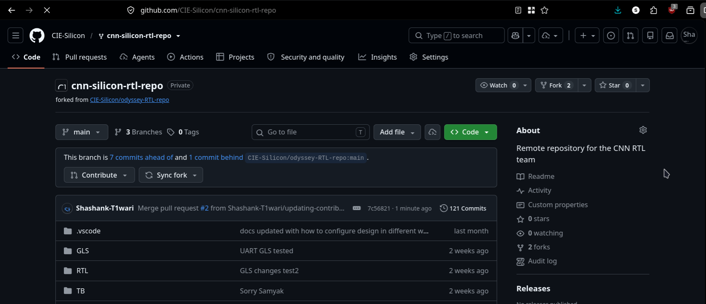

Delete your feature branch after the pull request is merged to keep your local repository clean. You can do this using the following command:

```bash
git branch -D <feature-branch-name>
```

The feature branch is automatically deleted from the server-side forked repository after the pull request is merged.

To sum it all up this is how the workflow looks like for 1 contributor:

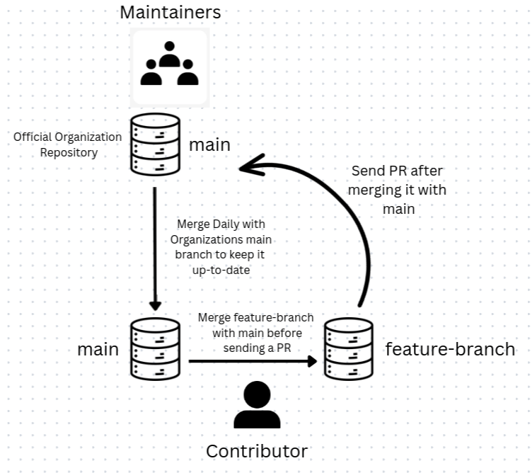